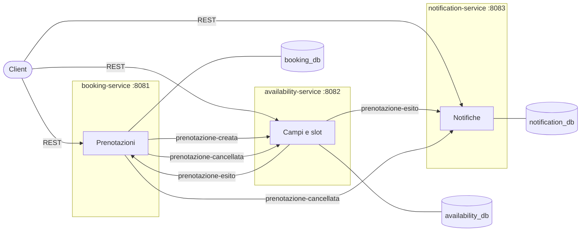
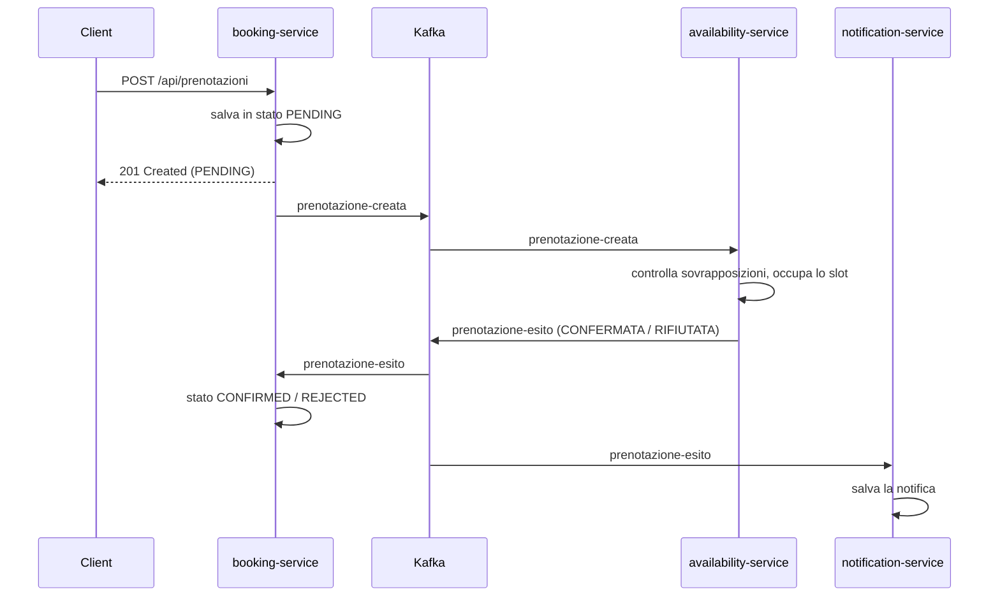
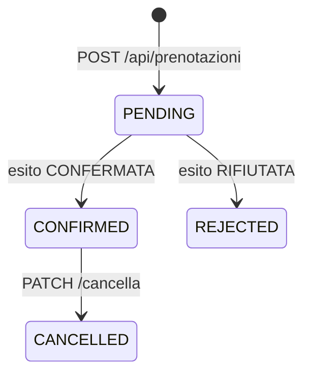

# CourtBook


Sistema di prenotazione di campi sportivi (padel, tennis, calcetto) costruito a **microservizi**.
I servizi comunicano esclusivamente tramite eventi **Apache Kafka**, ognuno con il proprio database **PostgreSQL**.

Il progetto gira sia con **Docker Compose** sia su **Kubernetes**, ed è verificato a ogni push da una pipeline **GitHub Actions**.

---

## Architettura



| Servizio | Responsabilità | Pubblica | Ascolta |
|---|---|---|---|
| **booking-service** | Crea e cancella le prenotazioni, ne gestisce lo stato | `prenotazione-creata`, `prenotazione-cancellata` | `prenotazione-esito` |
| **availability-service** | Gestisce campi e slot, decide se uno slot è libero | `prenotazione-esito` | `prenotazione-creata`, `prenotazione-cancellata` |
| **notification-service** | Salva le notifiche per l'utente (contenuto in JSONB) | — | `prenotazione-esito`, `prenotazione-cancellata` |

### Flusso di una prenotazione



### Ciclo di vita di una prenotazione



---

## Scelte progettuali

- **Database per servizio**: ogni servizio ha il proprio PostgreSQL. Tra servizi ci si riferisce solo tramite id (`idCampo`, `idPrenotazione`), mai con relazioni JPA.
- **Comunicazione solo asincrona**: nessuna chiamata REST tra servizi, solo eventi Kafka. Un servizio può essere temporaneamente spento senza bloccare gli altri.
- **Ordinamento per campo**: i messaggi hanno come chiave l'`idCampo`, quindi tutti gli eventi dello stesso campo finiscono nella stessa partizione e vengono elaborati in ordine.
- **Idempotenza**: Kafka garantisce la consegna *at-least-once*, quindi ogni consumer tollera i messaggi duplicati:
  - availability-service ignora una richiesta già elaborata (`idPrenotazione` univoco sugli slot);
  - booking-service aggiorna lo stato solo se la prenotazione è ancora `PENDING`;
  - notification-service ha un vincolo `UNIQUE (id_prenotazione, tipo)`.
- **Controllo delle sovrapposizioni**: uno slot è rifiutato se si sovrappone anche solo in parte a uno esistente (`inizio < fineEsistente AND fine > inizioEsistente`).
- **JSONB**: il contenuto delle notifiche cambia in base al tipo, quindi è salvato in una colonna `jsonb`.
- **Gestione errori**: `ErrorHandlingDeserializer` sui consumer; `@RestControllerAdvice` con risposte di errore uniformi sulle API REST.
- **Configurazione esterna**: lo stesso `application.properties` funziona da IDE, Docker e Kubernetes; cambiano solo le variabili d'ambiente.

---

## Tecnologie

| Ambito | Tecnologie |
|---|---|
| Backend | Java 25, Spring Boot 4.1, Spring Web, Spring Data JPA, Bean Validation, Lombok |
| Messaggistica | Apache Kafka 4.1 (modalità KRaft), Spring for Apache Kafka |
| Database | PostgreSQL 18 |
| Container | Docker (Dockerfile multi-stage), Docker Compose |
| Orchestrazione | Kubernetes (minikube) |
| CI | GitHub Actions (matrix sui tre servizi, PostgreSQL come service container) |

---

## Avvio con Docker Compose

Requisiti: Docker.

```bash
docker compose up -d --build
```

| Componente | Indirizzo |
|---|---|
| booking-service | http://localhost:8081 |
| availability-service | http://localhost:8082 |
| notification-service | http://localhost:8083 |
| Kafka UI | http://localhost:8080 |
| PostgreSQL (booking / availability / notification) | localhost:5433 / 5434 / 5435 |

All'avvio availability-service crea tre campi di esempio.

## Avvio su Kubernetes (minikube)

```bash
minikube start -p courtbook --memory=6g --cpus=4

docker compose build
minikube -p courtbook image load courtbook-booking
minikube -p courtbook image load courtbook-availability
minikube -p courtbook image load courtbook-notification

kubectl apply -f k8s/
kubectl get pods -n courtbook
```

Per raggiungere i servizi dal proprio computer:

```bash
kubectl port-forward -n courtbook svc/booking-service 8081:8081
kubectl port-forward -n courtbook svc/notification-service 8083:8083
```

---

## API

### booking-service (`:8081`)

| Metodo | Endpoint | Descrizione |
|---|---|---|
| POST | `/api/prenotazioni` | Crea una prenotazione (stato iniziale `PENDING`) |
| GET | `/api/prenotazioni` | Elenco delle prenotazioni |
| GET | `/api/prenotazioni/{id}` | Dettaglio di una prenotazione |
| PATCH | `/api/prenotazioni/{id}/cancella` | Cancella una prenotazione confermata |

Esempio di richiesta:

```json
{
  "idUtente": 1,
  "idCampo": 1,
  "inizio": "2026-12-10T18:00:00",
  "fine": "2026-12-10T19:00:00"
}
```

### availability-service (`:8082`)

| Metodo | Endpoint | Descrizione |
|---|---|---|
| POST | `/api/campi` | Crea un campo |
| GET | `/api/campi` | Elenco dei campi |
| GET | `/api/campi/{id}` | Dettaglio di un campo |
| GET | `/api/campi/{id}/slot?data=AAAA-MM-GG` | Slot occupati di un campo in una data |

### notification-service (`:8083`)

| Metodo | Endpoint | Descrizione |
|---|---|---|
| GET | `/api/notifiche/utente/{idUtente}` | Notifiche di un utente, dalla più recente |

---

## Struttura del repository

```
courtbook/
├── booking-service/          # Spring Boot, porta 8081
├── availability-service/     # Spring Boot, porta 8082
├── notification-service/     # Spring Boot, porta 8083
├── k8s/                      # Manifest Kubernetes
├── docker-compose.yml
└── .github/workflows/ci.yml  # Pipeline di CI
```
